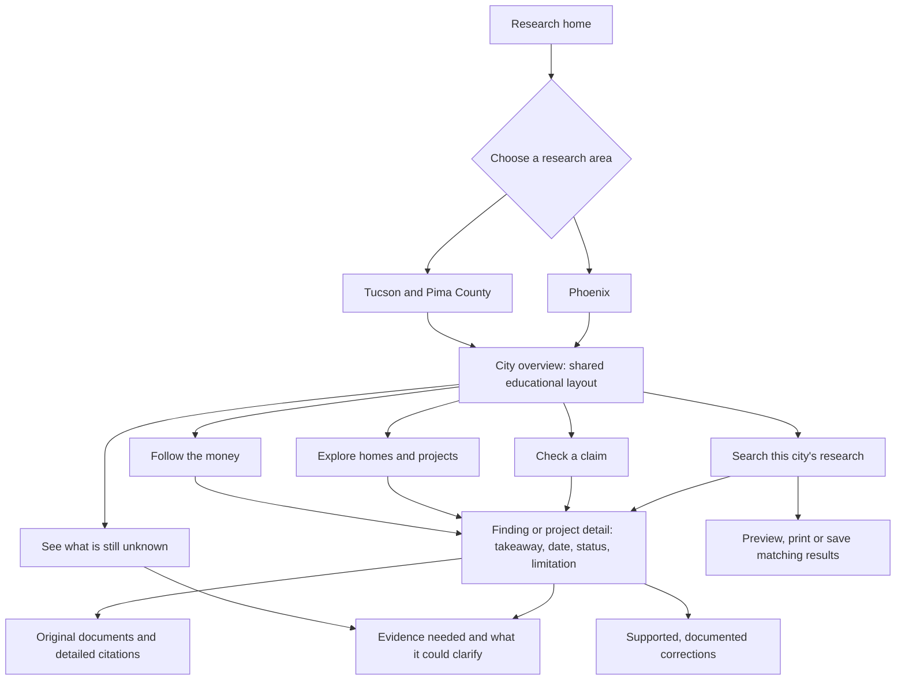
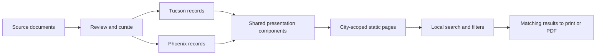

# A shared educational structure for Tucson and Phoenix

Both city sections use the same theme, layout and six main destinations: Overview, Projects, Funding, Questions, Sources and Search. A city switcher makes the research area explicit. Glossaries, reports, comparisons, correction history and housing help sit under **Learn & resources**. The underlying records remain scoped to their city.

## Reader flow



## Content layers

1. **Learn:** plain-language questions, a clear city scope and a few key concepts. Both city overviews offer the same four learning paths. Their three optional explainers distinguish approvals/payments, planned/completed housing, and geographic/reporting scope.
2. **Understand:** a finding or project file explains what a record shows, its date and status, why it matters, and its essential limitation. The Moreland file connects existing evidence for the two planned phases without adding financing measures together.
3. **Inspect:** document links, page/cell locators, program IDs, source comparisons and corrections are available when needed. Technical detail stays accessible without leading every page.

## Evidence-to-page flow



There is no automatic publication from a workbook or a changing external document. A supported correction preserves the old statement, corrected statement, reason, sources, prior public version and an accurate publication date. An unresolved source discrepancy is not a correction event.

## Implementation and maintenance

- `scripts/city_layout.py` supplies the common shell, city routes, overview learning modules and relative links. Its `apply()` function is used by generated pages; the command applies the same shell to hand-maintained pages. Research-area and program differences are encoded in destinations and content, not different visual systems.
- `assets/city-layout.css` and `assets/city-layout.js` control the shared educational theme and navigation. The decorative Sonoran Desert landscape is a generated illustration, not a photograph or claim about a specific project location. The original generation is retained separately; `assets/arizona-landscape.webp` is the web-optimized asset. Reading surfaces and print styles keep text clear.
- `assets/search-text.js` safely highlights matches using text nodes, including Unicode-normalized text. Queries remain local. Result explanations identify matching fields. Phoenix source-facet counts apply the query and all other selected source filters while varying the candidate choice; the selected criteria are kept free of counts in print reports.
- `data/phoenix-connections.json` adds the Moreland page's explicit phase, timeline and question relationships. The page reuses the three published Moreland findings; no external recheck or new spending total is implied.
- `data/phoenix-corrections.json` starts with an honest empty history. Every future entry requires `id`, `published_on` (an accurate publication date), `record_ids`, `previous_statement`, `corrected_statement`, `reason`, `source_ids` and an HTTPS `previous_reference_url`. Dates are not filled from the build clock. The renderer validates record/source references and preserves both statements.

After a source or relationship change, regenerate in order:

```sh
python scripts/build-phoenix-records.py
python scripts/build-phoenix-connections.py
python scripts/build-phoenix-project-pages.py
python scripts/city_layout.py
python scripts/build-reader-data.py
python scripts/build-search-source-urls.py
```

Then run the Phoenix data checks, existing reader/data/search checks, the browser search/print suites, and `node scripts/test-city-reader-journeys.mjs`. The shared shell is outside the indexed research; educational navigation and scope guidance are excluded from research indexing. Existing claim IDs and source dates remain attached to the research.
