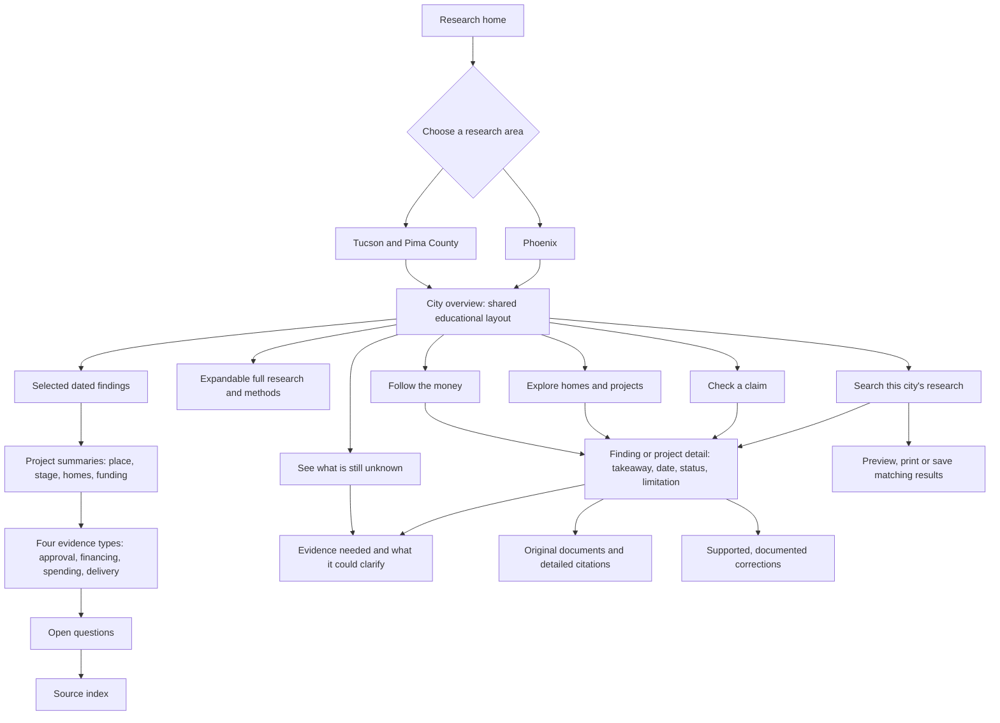
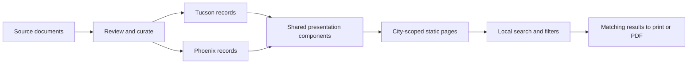

# A shared educational structure for Tucson and Phoenix

Both city sections use the same theme, layout and six research destinations: Overview, Projects, Funding, Questions, Sources and Search. About remains a visible main-navigation destination alongside them, including the separately published About-navigation update. A city switcher makes the research area explicit. Glossaries, reports, comparisons, correction history and housing help sit under **Learn & resources**. The underlying records remain scoped to their city.

The approved website mockups are implemented as a shared system across all 29 existing pages. City overviews have matching panoramic headings and compact reading sections. Other research and reference pages share a narrower landscape band, common typography, grouped footer links and the same navigation. The design uses the existing web landscape illustration and exact repository research rather than copying illustrative mockup text.

The shared renderer appends content hashes to the changed stylesheet and interaction scripts. A new HTML release therefore requests the matching design assets instead of relying on a reader's cached earlier menu/filter code. Hashes are deterministic and do not change source or publication dates. The offline preview resolves these asset URLs locally when embedding them.

At phone widths, a navigation drawer offers city switching, the six research routes, learning resources and utility links. It traps focus while open, makes the background inert, returns focus on Escape/close, and restores normal navigation on desktop resize. Without JavaScript, ordinary navigation remains visible. The glossary combines local initial-letter and text filters. Project directories combine their existing topic/type search with a separate evidence-stage filter; a phase can have more than one evidence-stage label.

## Reader flow



## Content layers

1. **Learn:** an unobscured Arizona landscape, one short introduction and the same four learning paths. Both city overviews follow key findings → projects and funding → open questions → sources. A visible update/snapshot date and city label stay beside the introduction; longer scope notes are optional.
2. **Understand:** project summaries lead with place, stage/date, homes and funding, followed by an essential qualification. Four native disclosures explain approval, financing, spending and housing-delivery records. They explicitly describe different measures, not a guaranteed sequence. The Moreland file keeps its two planned phases separate.
3. **Inspect:** the original research, updates and methods remain in an expandable library with their original IDs. Saved and repeated links reveal the relevant disclosure; printing expands the context and restores the reader's state. Document links, locators, comparisons and corrections remain available on their existing pages.

## Evidence-to-page flow



There is no automatic publication from a workbook or a changing external document. A supported correction preserves the old statement, corrected statement, reason, sources, prior public version and an accurate publication date. An unresolved source discrepancy is not a correction event.

## Implementation and maintenance

- `scripts/city_layout.py` supplies the common shell, city routes, overview learning modules and relative links. Its `apply()` function is used by generated pages; the command applies the same shell to hand-maintained pages. Research-area and program differences are encoded in destinations and content, not different visual systems.
- `scripts/city_reader_guide.py` renders the selected overview examples and compact project summaries from `data/city-reader-guide.json`. The JSON is an editorial layer over existing evidence, not a new research dataset. Check each summary against its linked finding when changing it. The same builder updates both city overviews, both project directories and the Bell/Moreland introductions; repeated builds are stable.
- `scripts/city_design.py` applies the approved reading templates, resource guidance, evidence-stage controls, narrow landscape banners and project-story panels. Moreland's story uses the existing phase/timeline relationships; Bell's story keeps the dated authorization and later report separate, including the unverified amendment and restriction terms. Original finding articles and IDs remain below the story.
- `assets/city-layout.css` and `assets/city-layout.js` control the shared educational theme and navigation. The decorative Sonoran Desert landscape is a generated illustration, not a photograph or claim about a specific project location. The original generation is retained separately; `assets/arizona-landscape.webp` is the web-optimized asset. The homepage and both city overviews show the image clearly in its own area, alongside or above an opaque reading surface. No white wash covers the image. The decorative image is omitted from print.
- `assets/search-text.js` safely highlights matches using text nodes, including Unicode-normalized text. Queries remain local. Result explanations identify matching fields. Phoenix source-facet counts apply the query and all other selected source filters while varying the candidate choice; the selected criteria are kept free of counts in print reports.
- `data/phoenix-connections.json` adds the Moreland page's explicit phase, timeline and question relationships. The page reuses the three published Moreland findings; no external recheck or new spending total is implied.
- `data/phoenix-corrections.json` starts with an honest empty history. Every future entry requires `id`, `published_on` (an accurate publication date), `record_ids`, `previous_statement`, `corrected_statement`, `reason`, `source_ids` and an HTTPS `previous_reference_url`. Dates are not filled from the build clock. The renderer validates record/source references and preserves both statements.

Project-story source notes sit beside the timeline on wide screens and below it on phones. **Print project brief** builds a detached cited report with the key facts, dated evidence, open questions and a canonical link to the full appendix. The full page remains printable independently; cancellation and completed printing restore the original page. This shares no registration with the search-results print provider, whose full matching result sets remain intact.

After a source or relationship change, regenerate in order:

```sh
python scripts/build-phoenix-records.py
python scripts/build-phoenix-connections.py
python scripts/build-phoenix-project-pages.py
python scripts/city_layout.py
python scripts/build-reader-data.py
python scripts/build-search-source-urls.py
```

Then run the Phoenix data checks, existing reader/data/search checks, the browser search/print suites, and `node scripts/test-city-reader-journeys.mjs`. The shared shell is outside the indexed research; educational navigation and scope guidance are excluded from research indexing. Existing claim IDs and source dates remain attached to the research.

The shared-city suite also checks image loading, the opening phone viewport, the resources menu, guide destinations, expanded research at narrow widths, saved/repeated anchors, native reading without JavaScript, and real PDF context/state restoration. `node scripts/test-approved-site-design.mjs` checks the mobile focus trap/resize behavior, combined project filters and print criteria, glossary filtering and cited project briefs against the complete file. Use `docs/reader-testing-session.md` with unfamiliar readers to assess comprehension; automated passes are not a participant study.
